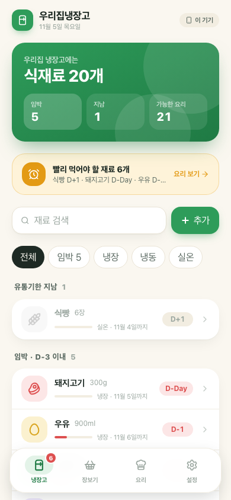
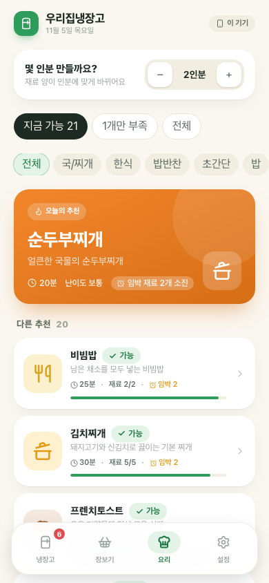
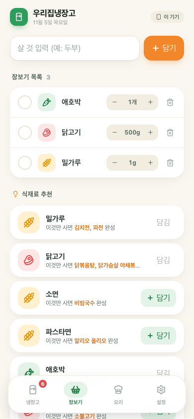
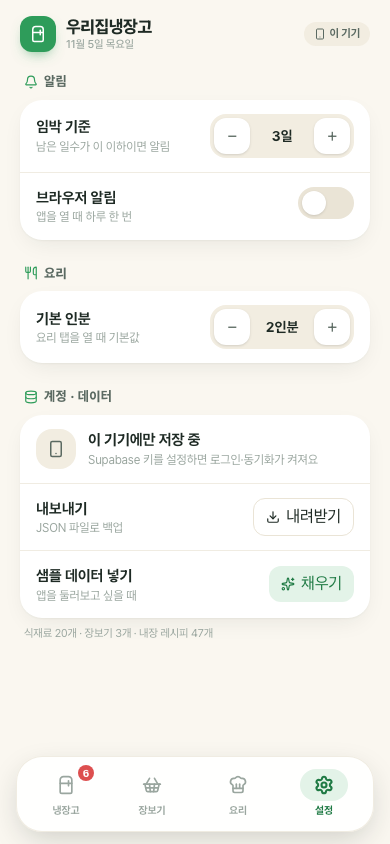

# 우리집냉장고 🧊

식재료 유통기한을 D-day로 관리하고, 있는 재료로 만들 수 있는 요리를 n인분 기준으로 추천해주는 웹앱.

**배포 주소:** https://eunsong2511.github.io/our-fridge/

## 화면
| 냉장고 | 요리 | 장보기 | 설정 |
|---|---|---|---|
|  |  |  |  |

체험용 샘플 데이터: 주소 뒤에 `?demo` 를 붙이거나 설정 탭에서 "샘플 데이터 넣기".

## 기능
1. **식료품 구매** — 장보기 목록에 담고, 체크한 항목을 냉장고로 한 번에 이동 (유통기한 자동 계산)
2. **유통기한 D-day** — 재료 이름을 입력하면 보관 방법(냉장/냉동/실온)에 맞는 유통기한을 자동 추천
3. **요리 추천** — 내장 레시피 47개를 보유 재료와 매칭. 인분 수를 바꾸면 재료 양이 환산되고, 요리 완료 시 재료를 자동 차감
4. **임박 알림** — 앱 내 배너 + 탭 배지 + (선택) 브라우저 알림. 임박 재료를 쓰는 요리를 먼저 추천
5. **식재료 추천** — "이것만 사면 OO 완성" 기준으로 살 재료 추천, 떨어진 상비 재료 알림

## 스택
Vite · React · TypeScript · Tailwind CSS v4 · Supabase(인증·DB, 선택) · GitHub Pages

Supabase 키가 없으면 브라우저(localStorage)에 저장하는 **로컬 모드**로 동작합니다.

## 로컬 실행
```bash
npm install
npm run dev
```

## Supabase 연결 (클라우드 동기화 켜기)
1. https://supabase.com 에서 새 프로젝트 생성
2. SQL Editor 에 `supabase/schema.sql` 내용을 붙여넣고 Run
3. Authentication → URL Configuration → Site URL 을 `https://eunsong2511.github.io/our-fridge/` 로 설정
   (가입 확인 메일 없이 바로 쓰려면 Authentication → Providers → Email → "Confirm email" 끄기)
4. Project Settings → API 의 `Project URL`, `anon public` 키를 GitHub 저장소 Secrets 에 등록
   - `VITE_SUPABASE_URL`
   - `VITE_SUPABASE_ANON_KEY`
   ```bash
   gh secret set VITE_SUPABASE_URL --body "https://xxxx.supabase.co"
   gh secret set VITE_SUPABASE_ANON_KEY --body "eyJ..."
   ```
5. Actions 에서 워크플로 재실행(또는 아무 커밋 푸시)

로컬 개발 시에는 `.env.example` 을 `.env` 로 복사해 같은 값을 넣으면 됩니다.

## 구조
```
src/
  data/ingredients.ts   재료 카탈로그 (별칭, 보관일, 기본 단위)
  data/recipes.ts       레시피 47개 (1인분 기준 분량 + 조리 순서)
  lib/match.ts          레시피 매칭·점수·식재료 추천 로직
  lib/storage/          local(localStorage) / supabase 저장소 어댑터
  components/           탭별 화면
supabase/schema.sql     테이블 + RLS 정책
```
